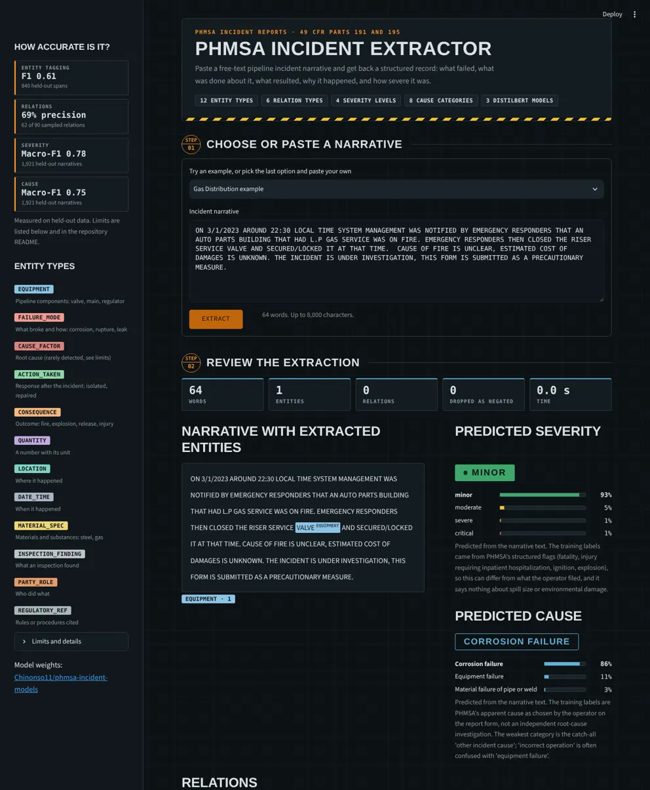

# PHMSA Incident Extraction

[](https://github.com/FranklinNwankwo/NLP_Unstructured_Data/actions/workflows/tests.yml)
[](https://github.com/FranklinNwankwo/NLP_Unstructured_Data/actions/workflows/model-regression.yml)
[](https://github.com/FranklinNwankwo/NLP_Unstructured_Data/actions/workflows/docker.yml)

**Turning free-text pipeline incident narratives into structured records: entities, relations between them, and a severity prediction, plus cited question answering over all incidents.**

## TL;DR

- **Problem.** PHMSA's 9,654 U.S. pipeline incident reports (2010 to present) each carry a free-text narrative that says what failed, why, what was done and what resulted, but none of it is structured or searchable.
- **What I built.** A pipeline that extracts 12 entity types, links them with relation rules, predicts severity and the apparent cause from the narrative, and answers questions over every incident with exact counts and cited reports.
- **Results on held-out data:**
  - **Entities:** micro-F1 **0.608** (fine-tuned DistilBERT), vs 0.553 spaCy, 0.564 an 8-shot LLM and 0.371 rules
  - **Relations:** **69%** precision on 90 hand-reviewed relations (recall not measured)
  - **Severity / cause:** macro-F1 **0.777** / **0.748**, vs 0.646 / 0.706 for TF-IDF + logistic regression; probabilities calibrated by temperature scaling (cause calibration error 0.134 → 0.050)
  - **Question answering:** **18/18** filters and counts correct; 18/18 answers with valid citations after a code check
- **In production terms.** Models pinned to one Hugging Face commit; CI re-scores the real models weekly and fails on any drop; a monthly batch run puts new PHMSA reports through the pipeline and reports drift, including live accuracy against PHMSA's own coded fields; a FastAPI service in a Docker image tested in CI.
- **What does not work.** Root-cause *spans* are not extracted (F1 0.00), so the cause is predicted per report instead; severity cannot see a death the narrative never mentions.
- **Try it:** [live demo](https://nlp-on-oil-and-gas-unstructured-data.streamlit.app) (sleeps when idle, so the first load is slow) · [models on Hugging Face](https://huggingface.co/Chinonso11/phmsa-incident-models) · [full engineering log](docs/ENGINEERING_LOG.md)
- **What I'd do next:**
  - Predict sub-causes (for example natural force damage, frost heave) on top of the 8 cause categories
  - Add a second annotator to measure label agreement, and gold relations to measure relation recall
  - Link cause and effect expressed by verbs and across sentences, where most of it lives




## Where to read more

Everything else (data audit, weak supervision, annotation, every training run, baselines, relation precision, severity analysis, deployment, decision register, mistakes and limitations) is in the **[engineering log](docs/ENGINEERING_LOG.md)**. Good starting points:

- [Results at a glance](docs/ENGINEERING_LOG.md#1-results-at-a-glance)
- [Architecture](docs/ENGINEERING_LOG.md#3-architecture)
- [The CAUSE_FACTOR investigation](docs/ENGINEERING_LOG.md#104-the-cause_factor-investigation) and [cause classification instead](docs/ENGINEERING_LOG.md#128-cause-classification-why-did-it-happen-cause_model)
- [Prompted-LLM baseline](docs/ENGINEERING_LOG.md#107-baseline-c-a-prompted-llm-baselinesbaseline_llmpy) and [bigger model](docs/ENGINEERING_LOG.md#108-does-a-bigger-model-help-distilbert-vs-bert-base-notebooksner_model_comparisonipynb)
- [MLOps: pinned models, regression tests, drift monitoring, API](docs/ENGINEERING_LOG.md#21-mlops-pinned-models-regression-tests-monitoring-and-serving)
- [Limitations and threats to validity](docs/ENGINEERING_LOG.md#15-limitations-and-threats-to-validity)
- [Decision register](docs/ENGINEERING_LOG.md#16-decision-register) and [mistakes, corrections and dead ends](docs/ENGINEERING_LOG.md#17-mistakes-corrections-and-dead-ends)

## Quickstart

```python
# download the three models from the Hugging Face Hub
from huggingface_hub import snapshot_download
path = snapshot_download("Chinonso11/phmsa-incident-models")
# copy <path>/ner      -> ner_model/phmsa_ner_model
#      <path>/severity -> severity_model/phmsa_severity_model
#      <path>/cause    -> cause_model/phmsa_cause_model
```

```
python pipeline/run_pipeline.py --text "YOUR NARRATIVE HERE"
streamlit run demo/space/app.py
uvicorn serving.api:app --port 8000        # REST API (or: docker build -f serving/Dockerfile -t phmsa-api .)
```

Setup details, offline tests and the full reproduction order are in the [engineering log](docs/ENGINEERING_LOG.md#5-setup-and-quickstart).

**Status:** a portfolio project built on public U.S. government records. Not validated for operational, safety or regulatory use.